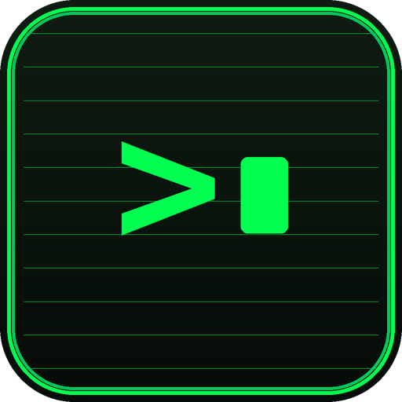
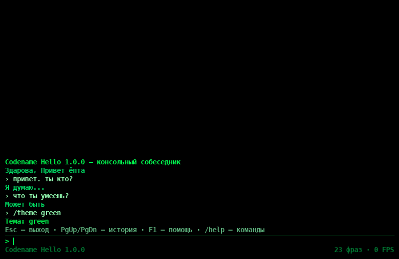
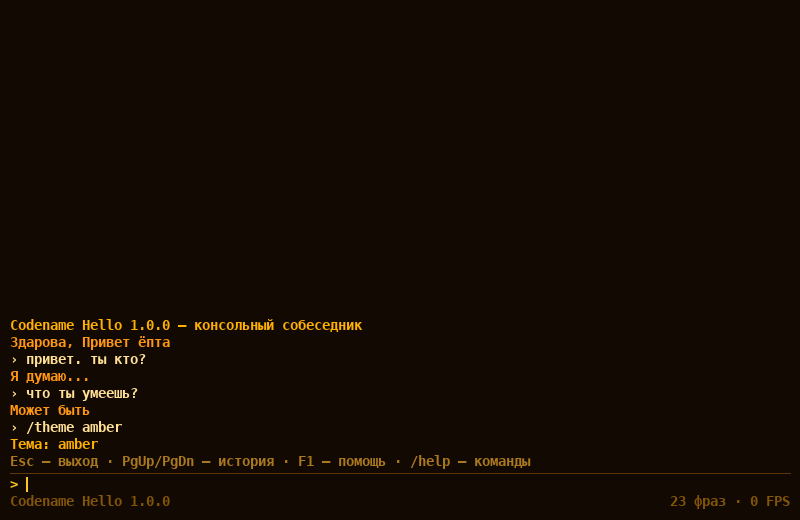
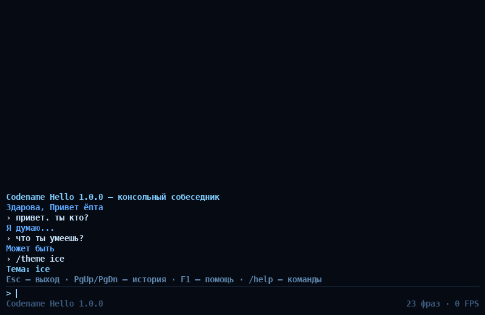

# Codename Hello

> Консольный собеседник с памятью фраз и цепью Маркова.
> Начат в 2012 году как эксперимент на SDL 1.2, перезапущен в 2026-м на SDL2.

<p align="center">
  
</p>

<p align="center">
  
</p>

---

## Что это

`Hello` — не языковая модель и не «искусственный интеллект». Это маленькая
программа, которая:

1. **Помнит** все фразы, которые ей написали (и 23 встроенные).
2. **Ищет** среди них ближайшую по звучанию и структуре — не по смыслу.
3. **Сочиняет** новую фразу цепью Маркова, когда уверенности не хватает.

Изначально это был консольный цикл на C, который на каждую введённую строку
переставлял массив фраз по самодельному коэффициенту совпадения. В 2013-м
появилось окно на SDL 1.2 с моноширинным шрифтом DejaVu Sans Mono Bold.
В 2026-м проект переехал на SDL2, получил нормальную архитектуру, тесты
и математику вместо самодельных эвристик.

## Быстрый старт

### Windows (MSYS2 / UCRT64)

```bash
pacman -S --needed mingw-w64-ucrt-x86_64-gcc \
    mingw-w64-ucrt-x86_64-cmake mingw-w64-ucrt-x86_64-ninja \
    mingw-w64-ucrt-x86_64-SDL2 mingw-w64-ucrt-x86_64-SDL2_ttf

cmake -S . -B build -G Ninja -DCMAKE_BUILD_TYPE=Release
cmake --build build
./build/hello.exe
```

### Linux

```bash
sudo apt install build-essential cmake libsdl2-dev libsdl2-ttf-dev
cmake -S . -B build -DCMAKE_BUILD_TYPE=Release
cmake --build build
./build/hello
```

### macOS (Homebrew)

```bash
brew install cmake sdl2 sdl2_ttf
cmake -S . -B build -DCMAKE_BUILD_TYPE=Release
cmake --build build
./build/hello
```

### Тесты

```bash
ctest --test-dir build --output-on-failure
```

522 проверки, внешних зависимостей нет — только стандартная библиотека C11.

## Как это работает

Три слоя, каждый со своей математикой.

### 1. Поиск похожей фразы

Текст нормализуется (нижний регистр, без пунктуации) и превращается
в массив кодпоинтов UTF-8. Дальше считаются три метрики:

| Метрика | Что ловит | Формула |
|---|---|---|
| **Дайс по биграммам** | общую структуру | `2·\|A∩B\| / (\|A\|+\|B\|)` |
| **Джаро–Уинклер** | общий префикс, опечатки | `J + ℓ·p·(1−J)`, `p = 0.1` |
| **Левенштейн** | редакционное расстояние | классическая ДП |

Итог — взвешенная сумма `0.50·Дайс + 0.25·Джаро + 0.25·Левенштейн` плюс
бонус `0.16`, если одна фраза целиком входит в другую («дела» ⊂ «как дела»).

### 2. Взвешивание слов (BM25)

Редкие слова важнее частых. Для запроса `q` и документа `d`:

```
score = Σ IDF(qᵢ) · (tf · (k₁+1)) / (tf + k₁·(1 − b + b·|d|/avgdl))
IDF(qᵢ) = ln(1 + (N − n(qᵢ) + 0.5) / (n(qᵢ) + 0.5))
```

`k₁ = 1.4`, `b = 0.72`. BM25 добавляет 30 % к итоговой оценке и не даёт
короткой фразе «Да» выиграть у длинной точной формулировки.

### 3. Цепь Маркова

Когда лучшая оценка ниже порога (или включён `/say`), бот строит новую фразу.
Модель — цепь порядка 2 (контекст из двух слов) со сглаживанием «глупый
бэкофф»: если для пары слов продолжений нет, пробуем одно слово, потом
начало предложения.

Температура `T` управляет «сумасшествием» через степенное распределение
`p_i ∝ w_i^(1/T)`:

| `T` | Поведение |
|---|---|
| 0.7 | сдержанно, почти цитаты |
| 1.0 | естественно |
| 1.6 | сумбурно, но иногда гениально |

Дополнительно считается **перплексия** `2^H` — насколько текст «удивляет»
модель. Она видна в `/stats` и используется для оценки качества обучения.

### Политика «не повторяться»

У каждой фразы есть счётчик использований. Вес умножается на
`1 / (1 + 0.35·uses)`, но не ниже `0.5` — так точное совпадение остаётся
точным, а бот не заедает одну и ту же реплику.

## Интерфейс

<p align="center">
  
  
</p>

### Клавиши

| Клавиша | Действие |
|---|---|
| `Enter` | отправить |
| `Esc` | выход |
| `PgUp` / `PgDn` | прокрутка истории |
| `↑` / `↓` | история ввода |
| `Shift+↑` / `Shift+↓` | прокрутка на строку |
| `←` / `→` | курсор по символам UTF-8 |
| `Ctrl+←` / `Ctrl+→` | в начало / в конец |
| `Home` / `End` | начало / конец строки |
| `Backspace` / `Delete` | удаление с учётом UTF-8 |
| `Ctrl+V` | вставка из буфера |
| `Ctrl+S` | сохранить память |
| `Ctrl+L` | очистить экран |
| `F1` | справка |
| `F11` | полный экран |
| колесо мыши | прокрутка |

### Команды

| Команда | Что делает |
|---|---|
| `/help` | справка |
| `/theme [имя]` | список или смена темы: `green`, `amber`, `ice`, `paper` |
| `/say <тема>` | сочинить ответ цепью Маркова |
| `/stats` | фразы, сообщения, FPS, размер цепи, перплексия |
| `/forget` | забыть выученное |
| `/save`, `/load` | память на диск |
| `/clear` | очистить экран |
| `/about` | о программе |
| `/quit` | выход |

## Конфигурация

`hello.cfg` рядом с исполняемым файлом (или `--config путь`):

```ini
# Codename Hello — конфигурация
width = 800
height = 520
font_size = 14
max_lines = 2000
fps_limit = 0          # 0 = без ограничения
vsync = true
theme = green
font = assets/fonts/DejaVuSansMono-Bold.ttf
memory = hello.memory
history = hello.history
```

Кривые строки и неизвестные ключи игнорируются — конфиг не может уронить
приложение. Значения клампятся в разумные границы.

### Параметры командной строки

```
--config <файл>      прочитать настройки
--width <пикс>       ширина окна
--height <пикс>      высота окна
--font <файл>        путь к TTF
--font-size <пикс>   размер шрифта
--theme <имя>        green | amber | ice | paper
--memory <файл>      файл памяти бота
--history <файл>     файл истории ввода
--no-vsync           отключить вертикальную синхронизацию
--screenshot <файл>  отрисовать демо-кадр в BMP и выйти
-h, --help           справка
-V, --version        версия
```

## Структура репозитория

```
Hello/
├── src/                      основная линия (SDL2)
│   ├── main.c                аргументы, запуск
│   ├── app.c                 окно, цикл, команды, ввод
│   ├── chat.c/.h             память фраз + выбор ответа
│   ├── markov.c/.h           цепь Маркова
│   ├── text_metrics.c/.h     Дайс, Жаккар, Левенштейн, Джаро, энтропия
│   ├── utf8.c/.h             UTF-8 без зависимостей
│   ├── input.c/.h            строка ввода и история
│   ├── view.c/.h             прокрутка и перенос строк
│   ├── render.c/.h           текст → текстура
│   ├── theme.c/.h            цветовые схемы
│   ├── config.c/.h           ini-подобный конфиг
│   └── icon_rgba.h           иконка (генерируется)
├── tests/                    юнит-тесты (522 проверки)
├── tools/                    генератор иконки, RE-скрипты
├── assets/                   иконки, шрифт DejaVu
├── docs/                     документация
│   ├── ARCHITECTURE.md
│   ├── MATH.md
│   ├── ARCHIVE.md
│   ├── BUILD.md
│   └── screenshots/
├── archive/                  исторические варианты (см. ARCHIVE.md)
│   ├── 2012-07-console-bot/
│   ├── 2012-opengl-cube/
│   ├── 2012-oglconsole/
│   ├── 2012-sdl-resize/
│   ├── 2012-12-hello-test-tree/
│   ├── 2013-01-03-sdl-console/
│   ├── 2013-autotools/
│   ├── 2015-03-primegen/
│   ├── 2015-design/
│   └── third-party/
├── refs/                     рабочая папка для разбора (в git не попадает)
├── CMakeLists.txt
├── LICENSE
└── README.md
```

**Важно:** `archive/` — это не «мусор», а зафиксированная история идей.
Каждый подкаталог — отдельный вариант, который жил своей жизнью.
Подробности в [`docs/ARCHIVE.md`](docs/ARCHIVE.md).

## Документация

| Файл | О чём |
|---|---|
| [`docs/ARCHITECTURE.md`](docs/ARCHITECTURE.md) | устройство кода, потоки данных, решения |
| [`docs/MATH.md`](docs/MATH.md) | все формулы с выводом и примерами |
| [`docs/ARCHIVE.md`](docs/ARCHIVE.md) | инвентаризация исторических вариантов |
| [`docs/BUILD.md`](docs/BUILD.md) | сборка на всех платформах, CI, упаковка |

## Лицензия

Код — **MIT**, см. [`LICENSE`](LICENSE).

Проект прошёл путь Unlicense → «DartPower'а Лицензия» (пародия на GPLv3) →
MIT. Обе прошлые версии сохранены в
[`archive/license-history/`](archive/license-history/) вместе с разбором.

Шрифт DejaVu — [`assets/fonts/LICENSE`](assets/fonts/LICENSE) (свободная
лицензия Bitstream Vera / DejaVu). Исторические варианты в `archive/`
сохраняют лицензии своих авторов — см. `docs/ARCHIVE.md`.

---

<p align="center">
  <sub>2012–2013: SDL 1.2 · 2026: SDL2, CMake, 522 теста</sub>
</p>
